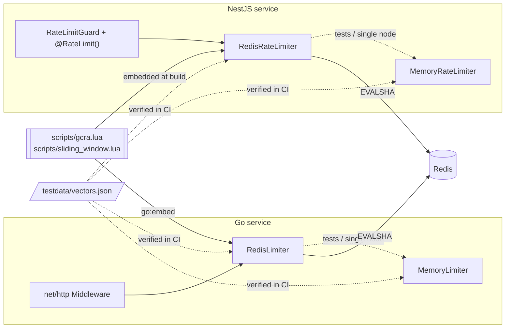

# ratelimit

[](https://github.com/neerajsinghi/ratelimit/actions/workflows/ci.yml)
[](https://pkg.go.dev/github.com/neerajsinghi/ratelimit)
[](LICENSE)

**Distributed rate limiting on Redis for Go and NestJS, with identical semantics in both.**

One set of atomic Redis Lua scripts, two first-class client libraries:

- **Go**: `github.com/neerajsinghi/ratelimit`, with a `Limiter` interface, Redis and in-memory backends, and `net/http` middleware.
- **NestJS**: `@neerajsinghi/nest-ratelimit`, with a module, a guard and a `@RateLimit()` decorator on top of ioredis.

A Go API gateway and a NestJS service that point at the same Redis can enforce **the same limit on the same key** and agree on every decision, down to the microsecond in `Retry-After`.

## Why

Polyglot backends usually end up with two rate limiters: one per language, each with its own algorithm, key format, rounding and headers. Then a client sees `Retry-After: 30` from one service and `Retry-After: 29` from the other, or gets 101 requests through a "100 per minute" limit because the two implementations count differently.

This project fixes that by construction:

- The algorithms are written **once**, as Lua scripts in [`scripts/`](scripts), and run atomically inside Redis.
- Both libraries execute those exact files. Nothing is ported by hand.
- Each library also ships an in-memory implementation that mirrors the Lua arithmetic line for line, for tests and single-instance services.
- A shared set of test vectors ([`testdata/vectors.json`](testdata/vectors.json)) is checked against **all four backends** (Go memory, Go Redis, Node memory, Node Redis) in CI, so they cannot drift apart.

## Features

- **Two algorithms**: GCRA (smooth, burst-tolerant, one key per client) and a sliding-window counter (O(1) memory, no fixed-window burst at boundaries).
- **Atomic and race-free**: every decision is a single `EVALSHA` (falling back to `EVAL`), so there are no read-modify-write races between instances.
- **Clock-skew safe**: by default the scripts read the Redis server clock (`TIME`), so app hosts with drifting clocks still agree.
- **Weighted requests**: consume `n` units per call (for example, a bulk endpoint costs 10), or peek with `n = 0`.
- **Standard headers**: `RateLimit-Limit`, `RateLimit-Remaining` and `RateLimit-Reset` (IETF draft), plus `Retry-After` and `429 Too Many Requests` when denied.
- **Fail-closed by default**: if Redis is unreachable, requests get `503`. Set fail-open with one option.
- **Works with** `redis.Client`, `redis.ClusterClient` and `redis.Ring` in Go, and ioredis `Redis` and `Cluster` in Node.js. Each limiter touches exactly one key per call, so it is Redis Cluster safe.

## Quickstart: Go

```sh
go get github.com/neerajsinghi/ratelimit
```

```go
package main

import (
	"net/http"

	"github.com/neerajsinghi/ratelimit"
	"github.com/redis/go-redis/v9"
)

func main() {
	rdb := redis.NewClient(&redis.Options{Addr: "localhost:6379"})

	// 100 requests per minute per client, GCRA by default.
	limiter := ratelimit.NewRedis(rdb, ratelimit.PerMinute(100))

	mux := http.NewServeMux()
	mux.HandleFunc("/", func(w http.ResponseWriter, r *http.Request) {
		w.Write([]byte("hello"))
	})

	// Key by API key when present, else by client IP.
	mw := ratelimit.Middleware(limiter,
		ratelimit.WithKeyFunc(ratelimit.KeyChain(
			ratelimit.KeyByHeader("X-API-Key"),
			ratelimit.KeyByIP(),
		)),
	)
	http.ListenAndServe(":8080", mw(mux))
}
```

Use the limiter directly anywhere, not just in HTTP:

```go
limiter := ratelimit.NewRedis(rdb, ratelimit.PerSecond(10),
	ratelimit.WithAlgorithm(ratelimit.SlidingWindow))

res, err := limiter.Allow(ctx, "tenant:acme:exports", 1)
if err != nil {
	return err // Redis unavailable
}
if !res.Allowed {
	return fmt.Errorf("slow down, retry in %s", res.RetryAfter)
}
```

| Go API | Purpose |
| --- | --- |
| `NewRedis(client, limit, opts...)` | Distributed limiter on Redis |
| `NewMemory(limit, opts...)` | In-process limiter with the same semantics |
| `PerSecond(n)`, `PerMinute(n)`, `PerHour(n)`, `Limit{Requests, Period}` | Rates |
| `WithAlgorithm`, `WithPrefix`, `WithClock` | Limiter options |
| `Middleware(l, opts...)` | `net/http` middleware |
| `WithKeyFunc`, `WithCost`, `WithFailOpen`, `WithDeniedHandler`, `WithErrorHandler` | Middleware options |
| `KeyByIP()`, `KeyByHeader(name)`, `KeyChain(fns...)` | Key functions |
| `SetHeaders(h, res)` | Write the headers yourself (gRPC gateways, other routers) |

## Quickstart: NestJS

```sh
npm install @neerajsinghi/nest-ratelimit ioredis
```

```ts
import { Module } from '@nestjs/common';
import Redis from 'ioredis';
import { RateLimitModule } from '@neerajsinghi/nest-ratelimit';

@Module({
  imports: [
    RateLimitModule.forRoot({
      redis: new Redis(),          // omit to use the in-memory limiter
      algorithm: 'gcra',           // or 'sliding-window'
    }),
  ],
})
export class AppModule {}
```

```ts
import { Controller, Get, Post } from '@nestjs/common';
import { RateLimit, SkipRateLimit } from '@neerajsinghi/nest-ratelimit';

@RateLimit({ limit: 100, period: 60_000 })        // 100 req/min for the whole controller
@Controller('orders')
export class OrdersController {
  @Get()
  list() {}

  @RateLimit({ limit: 10, period: 60_000, cost: 5 }) // stricter, weighted
  @Post('export')
  export() {}

  @SkipRateLimit()
  @Get('health')
  health() {}
}
```

The guard is registered globally by default and only acts on routes with `@RateLimit()`, unless you set `defaultLimit`. Buckets are per route and per client (`<Controller>.<handler>:ip:<ip>`). Pass `name` to share one bucket across routes and `key` (or a module-wide `keyGenerator`) to identify clients by API key or user ID. `forRootAsync({ imports, inject, useFactory })` is available for config-driven setup.

## Algorithms

All times are integer microseconds inside the scripts, so every intermediate value is exact in Lua's IEEE doubles.

### GCRA (Generic Cell Rate Algorithm)

GCRA is a token bucket expressed as a single timestamp. For a limit of `L` requests per period `P`:

- the **emission interval** is `T = floor(P / L)`, the steady-state spacing between requests;
- the **burst tolerance** is `T * L`, so up to `L` requests can arrive at once;
- per key it stores only the **theoretical arrival time** (TAT), the time at which the bucket would be empty again.

For a request of cost `n` at time `now`:

```
tat     = max(stored_tat, now)
new_tat = tat + T * n
allow if  new_tat - T * L <= now      → store new_tat with a TTL of (new_tat - now)
else      Retry-After = (new_tat - T * L) - now
```

Example: 10 per second gives `T = 100ms`. Ten requests at once are all allowed. The eleventh is told to retry in 100ms, after which one request per 100ms gets through. After 1s idle the full burst is back. Memory per key is one string.

### Sliding-window counter

Time is cut into fixed windows of length `P`. The script keeps the counts of the current and previous window in one hash, then estimates the number of requests in the sliding window that ends now by weighting the previous window by how much of it still overlaps:

```
estimate = previous * (P - elapsed) / P + current
allow if estimate + n <= L
```

This avoids the classic fixed-window flaw, where `2L` requests can pass around a window boundary, while still using O(1) memory per key, unlike a sliding log. `Retry-After` is computed exactly: the moment the decaying previous window, or the next window, leaves room for `n` more.

**Which should I use?** GCRA if you want smooth pacing and an explicit burst (APIs, per-user quotas). Sliding window if you want "at most L in any window of P" behaviour that reads like the policy you wrote down.

## Architecture



**How the scripts are shared.** The Go module lives at the repository root, so it embeds `scripts/*.lua` directly with `go:embed`, which cannot reach parent directories. The NestJS package in [`nestjs/`](nestjs) runs [`tools/embed-lua.mjs`](nestjs/tools/embed-lua.mjs) before every `npm test` and `npm run build`. It reads `../scripts/*.lua` and writes `src/lua.generated.ts`, which is git-ignored and compiled into `dist/`. The published npm package is self-contained, and there is exactly one copy of each script in the repository.

**Shared key layout.** Keys are `prefix + algorithm + ":" + key` in both languages (`ratelimit:gcra:user:42`, `ratelimit:sw:user:42`), so a Go service and a Node.js service can share a bucket deliberately.

**Parity tests.** `go test -run TestParity -update` regenerates `testdata/vectors.json` (six configurations, 480 requests with random timing, keys and costs). Go checks it against `MemoryLimiter` and `RedisLimiter` via [miniredis](https://github.com/alicebob/miniredis). Jest checks it against `MemoryRateLimiter` and `RedisRateLimiter` via [ioredis-mock](https://github.com/stipsan/ioredis-mock). The scripts coerce every number to a float, so they behave the same under Redis's Lua 5.1 and under Lua 5.3 emulators.

## Development

```sh
# Go
gofmt -l . && go vet ./... && go test -race ./...

# NestJS
cd nestjs && npm ci && npm test && npm run build
```

No Redis server is needed for either test suite.

## Roadmap

- [ ] `RateLimit-Policy` header and the combined `RateLimit` structured field from the latest IETF draft
- [ ] Multiple limits per request (for example 10/s **and** 1000/h) in one round trip
- [ ] Exact sliding-window log algorithm for low limits
- [ ] gRPC unary and stream interceptors for Go
- [ ] Fastify adapter tests and GraphQL context support for NestJS
- [ ] Integration tests against real Redis and Redis Cluster in CI
- [ ] Prometheus metrics hooks (allowed, denied, errors)
- [ ] Local in-process cache for keys that are already denied, to shed load from Redis under attack

## License

[MIT](LICENSE) © 2026 Neeraj Singhi
